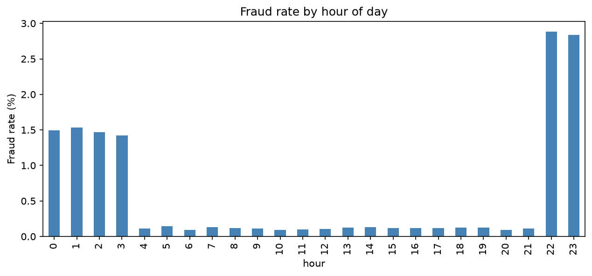
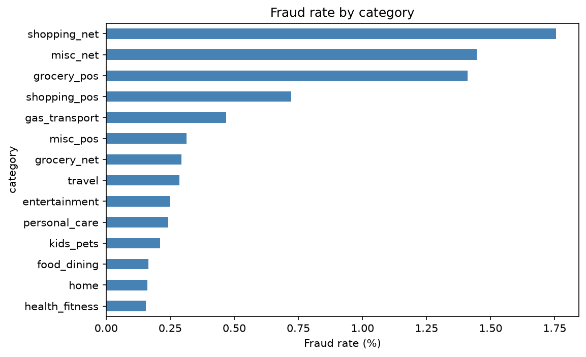
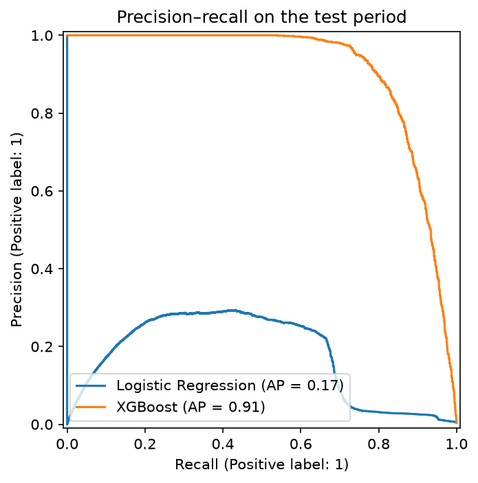
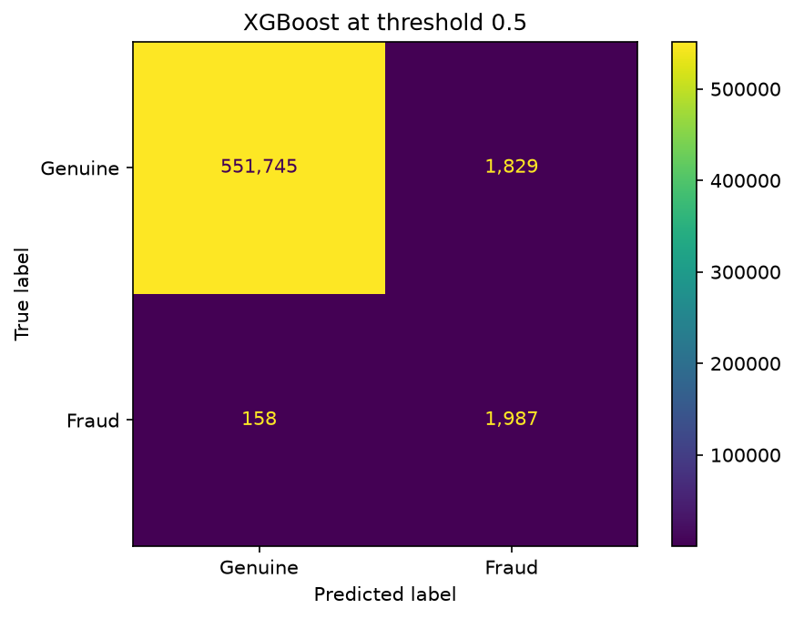
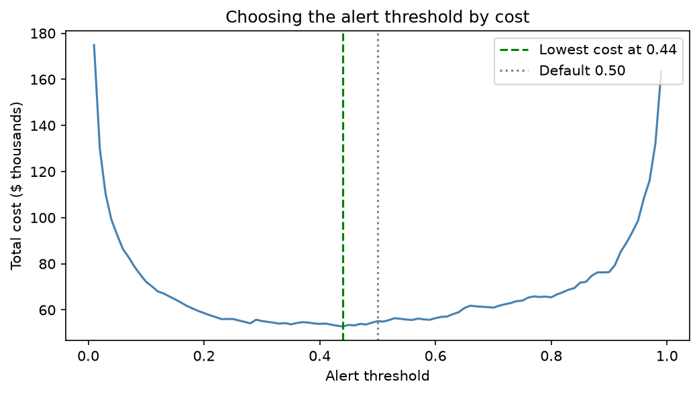
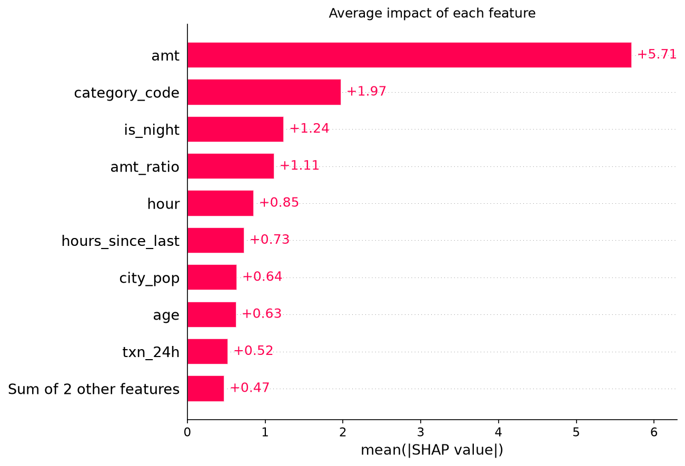
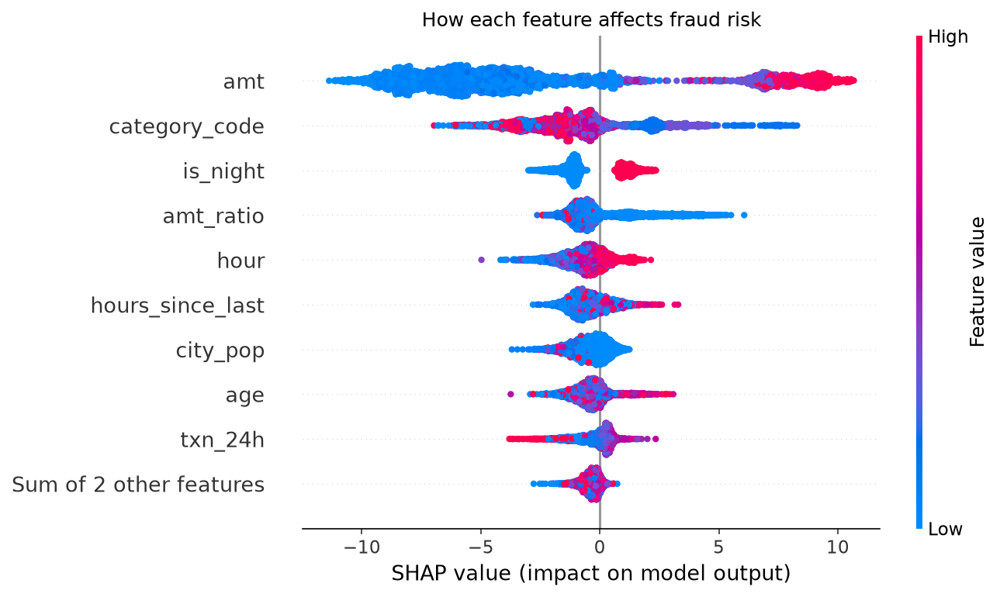

# FraudLens: Credit Card Fraud Detection

Work in progress.

## Data
Download from Kaggle: https://www.kaggle.com/datasets/kartik2112/fraud-detection
Place `fraudTrain.csv` and `fraudTest.csv` in the `data/` folder.

# FraudLens: Card Fraud Detection

**Live demo:** [fraudlens-shraddha.streamlit.app](https://fraudlens-shraddha.streamlit.app) <!-- replace with your real app link -->

A machine learning system that scores every card payment for fraud risk, explains each decision, and sets the alert threshold by **business cost** rather than the default 0.5.


---

## Results at a glance

| Metric | Result |
|---|---|
| PR-AUC (XGBoost) | **0.91** (vs 0.17 for logistic regression) |
| Fraud caught | **93.4%** |
| False alarms | **3.7 per 1,000 payments** |
| Fraud-related cost on the test period | **$1.13M → $52.8k (95% reduction)** |

All results are measured on **unseen future data**: the model was trained on earlier transactions and tested on later ones.

---

## The problem

Banks process millions of card payments a day, and about **0.5% are fraud**. Fraud teams can't review every payment, so they need a model that:

1. finds as much fraud as possible,
2. raises as few false alarms as possible (each one annoys a genuine customer and costs analyst time), and
3. can **explain** why a payment was flagged, for customers and regulators.

## Data

- **Source:** [Credit Card Transactions Fraud Detection (Sparkov), Kaggle](https://www.kaggle.com/datasets/kartik2112/fraud-detection)
- **Size:** 1.85M transactions (1.30M train, 0.56M test), about 0.5% fraud
- **Type:** synthetic US card transactions (amounts in USD)
- The data is not stored in this repo. Download it from Kaggle and place `fraudTrain.csv` and `fraudTest.csv` in `data/`.

## Approach

### 1. Exploration
Fraud is heavily concentrated **late at night** and in certain shop categories, and fraud amounts look very different from normal spending.

 

### 2. Feature engineering
I built behavioural features that answer the questions a fraud analyst would ask:

| Feature | Question it answers |
|---|---|
| `amt_ratio` | Is this amount unusual **for this customer**? |
| `txn_24h` | Is the card being used in a sudden burst? |
| `hours_since_last` | How soon after the previous payment? |
| `distance_km` | How far is the shop from the customer's home? |
| `hour`, `is_night`, `day_of_week` | Was it paid at an odd time? |
| `age`, `city_pop`, `category_code` | Customer and shop context |

**Avoiding data leakage:** customer averages use only **earlier** transactions, so the model never sees future information.

**Fairness:** I deliberately excluded `gender`, names, job and street address. Using protected attributes in a fraud or credit decision raises discrimination concerns.

### 3. Modelling
- **Time-based split:** train on Jan 2019–Jun 2020, test on Jul–Dec 2020. This mimics real use: learn from the past, predict the future.
- **Baseline:** logistic regression with class weighting.
- **Main model:** XGBoost with `scale_pos_weight` to handle the 1-in-200 class imbalance.
- **Metric:** PR-AUC, not accuracy. A model that predicts "not fraud" every time is 99.5% accurate and useless.

| Model | PR-AUC | ROC-AUC | Precision @0.5 | Recall @0.5 |
|---|---|---|---|---|
| Logistic Regression | 0.173 | 0.949 | 0.025 | 0.913 |
| **XGBoost** | **0.910** | **0.998** | **0.521** | **0.926** |

Logistic regression catches fraud but raises about 39 false alarms per real fraud. XGBoost wins because fraud depends on **combinations** (e.g. late night *and* online *and* unusually large), which a linear model can't capture.

 

### 4. Choosing the alert threshold by cost
Instead of the default 0.5, I chose the threshold that minimises total cost:

> **Total cost = value of missed fraud + $8 review cost per alert** (review cost is an assumption)

| Scenario | Fraud caught | False alarms / 1,000 | Total cost |
|---|---|---|---|
| No model | 0% | 0 | $1,133,325 |
| Threshold 0.50 | 92.6% | 3.3 | $55,089 |
| **Threshold 0.44 (chosen)** | **93.4%** | **3.7** | **$52,797** |



A sensitivity check shows the best threshold rises as review costs increase: when alerts are expensive, the bank should only act on the most certain ones.

### 5. Explainability (SHAP)
The strongest drivers of fraud risk are **transaction amount**, **shop category**, **night-time** and **amount relative to the customer's usual spend**.

 

I also examined a **false alarm**: a genuine customer flagged because their payment looked like typical fraud. In practice, a bank would handle cases like this with a quick verification text rather than a hard block.

### 6. Web app
A Streamlit app lets you enter a transaction and see:
- a fraud risk score and decision (approve / review / block),
- a SHAP explanation of **why**,
- model performance and fraud-pattern dashboards.

---

## Limitations

- **Synthetic data:** fraud patterns are cleaner than in real bank data, so real-world performance would be lower.
- **Heavy reliance on raw amount:** fraudsters adapt (e.g. by staying under limits). Behavioural features like `amt_ratio` and `txn_24h` are harder to fake and should be expanded.
- **Assumed costs:** the $8 review cost is an estimate. Real costs would come from the fraud operations team.
- **Static model:** a production system would need regular retraining and monitoring for drift as fraud patterns change.

## Next steps

- More behavioural features: merchant novelty (first time at this shop?), spending in the last hour, distance from the previous transaction.
- Probability calibration so scores can be read as true fraud probabilities.
- Real-time scoring with a streaming pipeline (e.g. Kafka).

---

## Project structure

```
FraudLens/
├── app/app.py                 # Streamlit app
├── notebooks/
│   ├── 01_explore.ipynb       # exploration
│   ├── 02_features.ipynb      # feature engineering
│   ├── 03_model.ipynb         # models + threshold
│   └── 04_explain.ipynb       # SHAP
├── models/                    # trained model, feature list, threshold
├── images/                    # charts used in this README
├── data/                      # not in repo (download from Kaggle)
└── requirements.txt
```

## How to run

```bash
git clone https://github.com/Shraddhatole/FraudLens.git
cd FraudLens
pip install -r requirements.txt
streamlit run app/app.py
```

To rerun the analysis, download the data from Kaggle into `data/` and run the notebooks in order.

## Tools

Python · pandas · scikit-learn · XGBoost · SHAP · Matplotlib · Streamlit · Git

---

**Author:** Shraddha Tole, MSc Data Science, University of Glasgow · [LinkedIn](https://www.linkedin.com/in/your-profile) <!-- replace with your LinkedIn URL -->